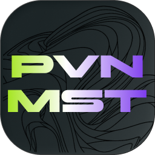
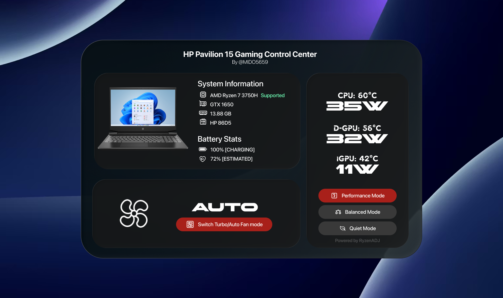

# Pavilion Master

**A sleek control center for the HP Pavilion 15 Gaming | live temperatures, power draw, CPU power profiles and fan control in one window.**

-2b2b2b?style=for-the-badge&logo=windows&logoColor=white)

[**⬇ Download**](../../releases/latest) · [Features](#-features) · [Install](#-installation) · [⚠ Warnings](#-important-warnings) · [Credits](#-credits--licenses)

---

## 📸 Screenshots

  

---

## ✨ Features

| | |
|---|---|
| 🌡️ **Live CPU monitoring** | Die temperature and package power, refreshed every second. Needs a supported CPU (it is read through the WinRing0 driver). The iGPU reading mirrors the CPU die, since they share one chip. |
| 🎮 **NVIDIA GPU monitoring** | Temperature and power draw through NVML. Shows `N/A` when there is no NVIDIA GPU. |
| ⚡ **Total power** | CPU + GPU draw combined in one big number. |
| 🚀 **Three power profiles** | **Performance**, **Balanced** and **Quiet**, applied through RyzenADJ with limits tuned per CPU. Each profile also switches the Windows power plan: Performance uses a *Pavilion Master Ultimate Performance* plan, Balanced uses Balanced, Quiet uses Power saver. |
| 🌀 **Turbo fan** | One click to push the fan to 100 %, one click back to automatic. |
| 🔋 **Battery stats** | Charge level, charging state and an *estimated* battery health. |
| 🖥️ **System information** | CPU, GPU, RAM and motherboard at a glance. |
| 🎨 **Colour variants** | Match the app to your laptop: Acid Green, Ghost White or Ultra Violet. You pick one on first launch and it is remembered. |
| 🛡️ **Limited mode on other CPUs** | On an unsupported CPU the app still opens, but the controls are disabled and it **never loads the driver or writes to hardware**. D-GPU, battery and system information still work. |

---

## 💻 Supported hardware

Pavilion Master is built for the **HP Pavilion 15 Gaming** with one of these AMD Ryzen H-series processors:

| CPU | Codename | Performance | Balanced | Quiet |
|---|---|:---:|:---:|:---:|
| Ryzen 7 **3750H** | Picasso | 38 / 45 / 40 W · 92 °C | 25 / 35 / 28 W · 85 °C | 15 / 20 / 17 W · 75 °C |
| Ryzen 5 **4600H** | Renoir | 50 / 60 / 54 W · 92 °C | 35 / 45 / 38 W · 85 °C | 25 / 30 / 27 W · 75 °C |
| Ryzen 7 **4800H** | Renoir | 54 / 65 / 58 W · 92 °C | 35 / 45 / 38 W · 85 °C | 28 / 35 / 30 W · 75 °C |
| Ryzen 5 **5600H** | Cezanne | 50 / 60 / 54 W · 92 °C | 35 / 45 / 38 W · 85 °C | 22 / 28 / 24 W · 75 °C |
| Ryzen 7 **5800H** | Cezanne | 54 / 65 / 58 W · 92 °C | 35 / 45 / 38 W · 85 °C | 25 / 32 / 28 W · 75 °C |

Values are sustained (STAPM) / fast / slow power limits and the Tctl temperature limit. They are sensible starting points based on AMD's published ranges, **not** values measured on every laptop.

> [!NOTE]
> **Any other CPU** — a different AMD model, or Intel — is treated as *unsupported*. The app still installs and opens, shows an "Unsupported Processor" screen, and the profile and fan controls are disabled. No WinRing0 driver is loaded and no hardware is written to. CPU temperature and power show `--` (they are read through that driver); D-GPU, battery and system information still work.

> [!WARNING]
> **Support is decided by the CPU model only — the app does not check the laptop model.** A different laptop or desktop that happens to have one of the five CPUs above is treated as supported, and the fan control then sends commands written for the HP Pavilion 15 Gaming's embedded controller. Don't use Pavilion Master on any other machine.

**Requirements:** Windows 10 (1809) or Windows 11, 64-bit. Nothing else needs to be installed — the Qt runtime is bundled.

---

## 📦 Installation

1. Go to the [**Releases**](../../releases/latest) page and download **`PavilionMaster-Bundle.zip`**.
2. **Extract the whole ZIP** (don't run the installer from inside the archive).
3. Double-click **`Install.bat`** and accept the administrator prompt.

The installer copies Pavilion Master to `C:\Program Files\Pavilion Master`, adds Start menu and desktop shortcuts, sets the app to always run as administrator, and launches it.

<b>Windows says "Windows protected your PC" (SmartScreen)</b>

The files are not code-signed, so Windows shows an "Unknown publisher" warning. Click **More info → Run anyway** if you trust the download. Only download Pavilion Master from this repository's Releases page.

### Uninstall

Use **Settings → Apps → Pavilion Master → Uninstall**, or run `Uninstall.bat` from the install folder. This removes the app, shortcuts, saved settings, the *Pavilion Master Ultimate Performance* power plan and the WinRing0 driver service.

---

## ⚠️ Important warnings

> [!CAUTION]
> **Use at your own risk.** Pavilion Master changes CPU power limits, temperature limits and fan behaviour. Aggressive settings can raise temperatures, cause instability or crashes, shorten component life, and may affect your warranty. The software is provided *as is*, without any warranty (see [LICENSE](LICENSE)). The author is not responsible for any damage or data loss.

> [!WARNING]
> **It installs a kernel driver with a known vulnerability.**
> On supported laptops the app loads **WinRing0** (`WinRing0x64.sys`), a third-party driver that gives programs raw access to CPU registers, I/O ports and the fan controller. Microsoft and antivirus vendors flag it because older versions of this driver family have a publicly known privilege-escalation vulnerability ([CVE-2020-14979](https://nvd.nist.gov/vuln/detail/CVE-2020-14979)). While the driver is installed, malware that is already running on your PC could try to abuse it.
> - Only use Pavilion Master on a PC you control and keep protected.
> - If you stop using the app, **uninstall it** — that removes the driver service.
> - Windows Security, Memory Integrity (HVCI) or the Microsoft vulnerable-driver blocklist may **quarantine or refuse to load** the driver. The app then opens in limited mode with the controls disabled. Disabling those protections is **your decision and your risk** — they exist for good reason.

> [!IMPORTANT]
> **Administrator rights are required.** Loading the driver and changing power limits needs an elevated process, so the app is set to always run as administrator and Windows will ask for confirmation each time.

> [!NOTE]
> **Unofficial project.** Pavilion Master is an independent fan-made tool. It is **not affiliated with, endorsed by or supported by HP, AMD or NVIDIA**. Support requests should not be sent to them.

**Also good to know**

- Fan control writes to the laptop's embedded controller and is designed for the HP Pavilion 15 Gaming only. The fan never goes below 38 %, and **Turbo** sets it to 100 %.
- Battery health is an **estimate**: the battery's reported full-charge capacity divided by a fixed design capacity of 52,553 mWh.
- The CPU power limits reset when the PC restarts or sleeps; re-apply a profile afterwards. The Windows power plan stays on whatever the last profile switched it to.
- Closing the app does not revert the profile that is currently applied. Pick **Balanced** before you quit if unsure.
- The first time you open the app on a supported laptop it asks you to choose a colour variant.

---

## 🛠️ Troubleshooting

<b>"Unsupported Processor" appears and the controls are greyed out</b>

Your CPU isn't one of the five supported models. Check `control_center.log` in the install folder — it says `Unsupported CPU` followed by the name Windows reports for your processor.

<b>The CPU shows "--" and the fan button does nothing on a supported laptop</b>

`control_center.log` will say `FanControl initialization failed`. The WinRing0 driver was probably blocked or deleted by Windows Security. Open **Windows Security → Virus & threat protection → Protection history**, review the entry for `WinRing0x64.sys`, and restore it only if you accept the risks described above. Then restart the app.

To check the driver service in a terminal: `sc query WinRing0_1_2_0`

<b>D-GPU shows N/A</b>

No NVIDIA GPU was found or the NVIDIA driver isn't installed. Update or reinstall your NVIDIA driver. Pavilion Master uses the driver's own `nvml.dll` when it exists.

<b>Where are the logs?</b>

`C:\Program Files\Pavilion Master\control_center.log`. Please attach it when you report a bug.

---

## Building
 
### Option A: GitHub Actions (no local tools)
 
Push the repository. The workflow in `.github/workflows/build.yml` builds the app on a Windows runner and packs everything into `PavilionMaster-Bundle.zip` (the app, `Install.bat`, `Uninstall.bat` and the runtime files). Download the `PavilionMaster-Bundle` artifact from the run's page under the **Actions** tab.

The bundle also needs four third-party files that are not built from this repo — `ryzenadj-real.exe`, `libryzenadj.dll`, `WinRing0x64.dll` and `WinRing0x64.sys`. Put them in the `redist/` folder (see `redist/README.txt`) or the build stops with an error.

**Publishing a release:** push a version tag, for example `git tag v0.9.9` then `git push origin v0.9.9`. The workflow builds the bundle and attaches `PavilionMaster-Bundle.zip` to a GitHub Release for that tag.
 
### Option B: Qt Creator (Windows)
 
1. Install Qt 6.5 or newer with the **Qt Quick** and **Qt Shader Tools** modules, using the MSVC 64-bit kit.
2. Open `CMakeLists.txt` in Qt Creator and configure the project with the MSVC kit.
3. Build in Release mode. This gives you the main executable only; the launcher, RyzenAdj shim, installer and `PavilionMaster-Bundle.zip` come from the GitHub Actions workflow.
Every `.ttf` / `.otf` file in `fonts/` is embedded into the executable at build time. Qt's `QFontDatabase` registers them at startup, so the app looks the same on PCs without those fonts installed. After changing the fonts folder, run **Build > Run CMake** before rebuilding.

---

## 🙏 Credits & licenses

Pavilion Master stands on the work of others. Huge thanks to everyone below.

### Created by
**@MIDO5659** — design and development.

### Third-party components

| Component | Credit | License | Used for |
|---|---|---|---|
| **[RyzenAdj](https://github.com/FlyGoat/RyzenAdj)** | **FlyGoat** and the RyzenAdj contributors | LGPL-3.0 | Applying the Ryzen power and temperature limits (`ryzenadj.exe`, `libryzenadj.dll`). Run as a separate program. |
| **NVML** (NVIDIA Management Library) | © **NVIDIA Corporation** | NVIDIA's own license (ships with the NVIDIA driver / CUDA Toolkit) | Reading NVIDIA GPU temperature and power (`nvml.dll`, `nvml.h`). |
| **[WinRing0](https://openlibsys.org/)** | **OpenLibSys.org** | BSD-style | Low-level access to CPU registers and the fan controller. |
| **[Qt 6](https://www.qt.io/)** | © The Qt Company Ltd. and contributors | LGPL-3.0 (dynamically linked) | The UI framework. Qt's source code is available from [qt.io](https://www.qt.io/download-open-source). |
| **Microsoft Visual C++ runtime** (`vcruntime140.dll`, `msvcp140.dll`) | © Microsoft Corporation | Microsoft's redistributable terms | C++ runtime for the compiled app. |

### Fonts

| Font | Credit | Used for |
|---|---|---|
| **Inter** | © 2020 **The Inter Project Authors** ([rsms/inter](https://github.com/rsms/inter)), licensed under the SIL Open Font License 1.1 (`fonts/Inter-OFL.txt`) | Main interface text. |
| **AKONY** | © 2023 **grinfleim**, designed by **Vladimir Klenov** | "TURBO ON" / "AUTO" and the large power numbers. |
| **Angled** | **Artyway** — designed by **Yehor Lisnyi** ([Creative Market](https://creativemarket.com/artyway)) | CPU / GPU temperature and "TOTAL" labels. |

> [!WARNING]
> **AKONY and Angled: credit only — no license.** These two fonts belong to their creators and are **not licensed to this project**. They are credited here out of respect for their authors; a credit is **not** a license or permission to use them. They are **not** covered by this project's MIT license, and nothing in this repository or release grants you any right to use, copy, extract or redistribute them. If you are a rights holder and would like a font removed or replaced, please open an issue and it will be taken down in the next release.

### Trademarks
HP and Pavilion are trademarks of HP Inc. AMD and Ryzen are trademarks of Advanced Micro Devices, Inc. NVIDIA, GeForce and NVML are trademarks and/or registered trademarks of NVIDIA Corporation. Windows is a trademark of Microsoft Corporation. All other trademarks belong to their respective owners. They are used here only to describe compatibility.

### Pavilion Master license
The original source code of Pavilion Master is released under the **[MIT License](LICENSE)** © 2026 MIDO5659. This covers **only** the author's own code. Third-party components keep their own licenses as listed above, and the **AKONY and Angled fonts are not licensed to this project** and are excluded from the MIT license entirely (see [Fonts](#fonts)). Inter is licensed separately under the SIL Open Font License.

---

Made with 💚💜 for the HP Pavilion 15 Gaming.

